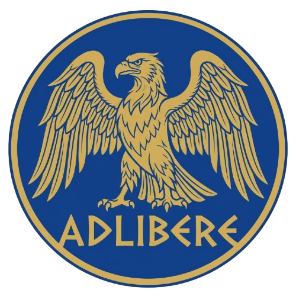
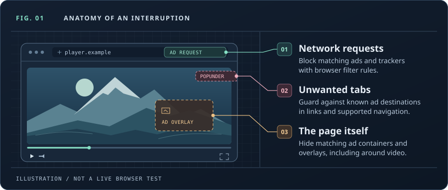

# adLibere



**Keep the player yours.**

adLibere blocks ads and trackers in Chromium and pays extra attention to the
things that get between you and a video: popunders, playback overlays, and common
anti-adblock checks.

[**Download adLibere 2.0.0**](https://github.com/emillvl/adLibere/releases/download/v2.0.0/adLibere-v2.0.0.zip)
· [SHA-256 checksum](https://github.com/emillvl/adLibere/releases/download/v2.0.0/adLibere-v2.0.0.zip.sha256)
· [Install instructions](#install)
· [Release notes](https://github.com/emillvl/adLibere/releases/tag/v2.0.0)

## The interruption isn’t always a request



- **At the network.** Chrome’s Manifest V3 filtering applies rules built from
  EasyList, EasyPrivacy, AdGuard Base, and local additions.
- **At the click.** Popup protection checks links and supported navigation for
  known ad destinations, including popunders.
- **On the page.** Scripts hide matching ad containers and playback overlays.
  Local replacement resources, ad API stubs, and bait handling cover some
  anti-adblock checks.

## Install

Use the versioned **`adLibere-vX.Y.Z.zip`** and its **`.zip.sha256`** file
from [GitHub Releases](https://github.com/emillvl/adLibere/releases).
The **Source code** archives are not installable builds. Node.js is not required.

1. Verify the ZIP’s checksum using the commands below, then extract it to a
   permanent folder with `manifest.json` directly inside.
2. In **Chrome 121 or later**, open `chrome://extensions` and turn on
   **Developer mode**.
3. Choose **Load unpacked** and select the extracted folder. Reload open pages,
   then click the adLibere icon to open the dashboard.

For Microsoft Edge, use `edge://extensions` and the same extracted folder.
See [tested browser versions and limits](docs/EDGE_COMPATIBILITY.md).
Firefox support is not configured.

<details>
<summary><strong>Verify the ZIP before opening it</strong></summary>

From your downloads folder, compare the ZIP hash with its checksum file.
Substitute the version you downloaded in each command.

**Windows PowerShell**

```powershell
(Get-FileHash -LiteralPath .\adLibere-v2.0.0.zip -Algorithm SHA256).Hash
Get-Content -LiteralPath .\adLibere-v2.0.0.zip.sha256
```

The hashes must match. Letter case does not matter.

**Linux**

```sh
sha256sum -c adLibere-v2.0.0.zip.sha256
```

**macOS**

```sh
shasum -a 256 -c adLibere-v2.0.0.zip.sha256
```

</details>

### Update an unpacked copy

GitHub installs do not update the extension automatically. Download and verify
the new ZIP, close the browser, and replace **all contents** of the already
loaded folder with the new extracted files. Keep the same folder path to retain
the unpacked extension identity and settings. Reopen the browser, click
**Reload** on the extension card, and refresh affected pages. Keep the last
working ZIP if you want the option to roll back.

## At the controls

| Dashboard control | What it does |
| --- | --- |
| **Active on all sites** | Pauses or resumes protection globally. Reload open pages so the change reaches scripts already injected. |
| **Update lists now** | Downloads fresh filter data and applies the dynamic rules that fit the browser’s rule budget. |
| **Export filter list** | Saves catalog network and site rules as `adlibere.txt`. It does not export the bundled lists or protection scripts. |

Protection starts on. adLibere checks for filter updates at startup and every
12 hours, skipping automatic downloads while the saved lists are less than
24 hours old. Refreshes only update dynamic filter data. They neither replace
packaged static rules and popup patterns nor update extension code. The
dashboard can show more downloaded rules than active dynamic rules.

The catalog export uses uBlock Origin syntax for redirects and scriptlets.
Other blockers may not support those entries.

### If a site misbehaves

Pause protection, then reload the page and check whether the player, captions,
menu, or sign-in flow works again. There is no per-site pause or exception
editor. If the problem only happens with protection on, [open an issue](https://github.com/emillvl/adLibere/issues)
with the URL, browser and extension versions, and steps to reproduce it.

adLibere supports a subset of upstream filter syntax. Some ads are delivered
through the same infrastructure as the content, so blocking them
indiscriminately can break playback. Overlay detection can miss ads or
misidentify site controls. The release’s browser smoke tests use synthetic
pages, not live streaming services. See the
[compatibility report](docs/EDGE_COMPATIBILITY.md) for scope and shared rule
budget limits.

## What stays local

Filtering and page inspection happen in the browser. Settings and downloaded
rules stay in local extension storage. There is no adLibere account,
developer-operated backend, analytics, or browsing-history collection. List
refreshes contact the filter providers directly.

| Permission | Why it’s needed |
| --- | --- |
| `declarativeNetRequest` | Apply browser network block and redirect rules. |
| `scripting` and `<all_urls>` | Run protection scripts on supported pages and frames. |
| `storage` and `unlimitedStorage` | Store settings, downloaded filters, and update metadata. |
| `alarms` | Schedule checks for filter updates. |

[Read the privacy policy](PRIVACY.md).

## Under the hood

With **Node.js 24 or later**, run `npm run build` to generate the loadable
`dist/` folder, or run `npm test` to rebuild and run the offline suite. There
are no npm dependencies to install.

[Development guide](docs/DEVELOPMENT.md)
· [Release procedure](docs/RELEASING.md)
· [Edge compatibility](docs/EDGE_COMPATIBILITY.md)

Source code is licensed under the [MIT License](LICENSE). Bundled filter
and benchmark data retain their upstream terms and attribution. See
[third-party notices](THIRD_PARTY.md).
